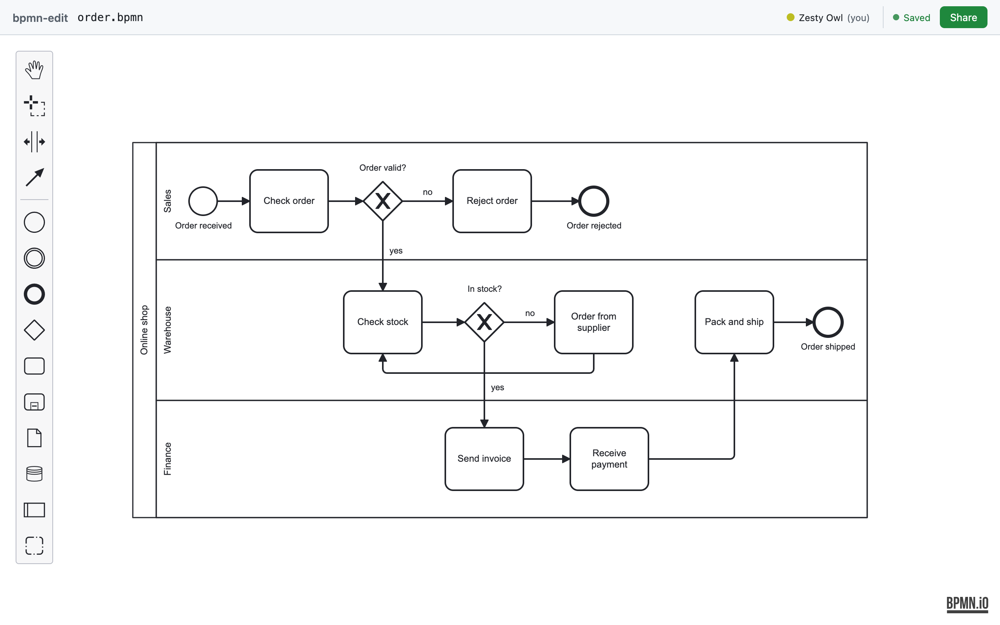
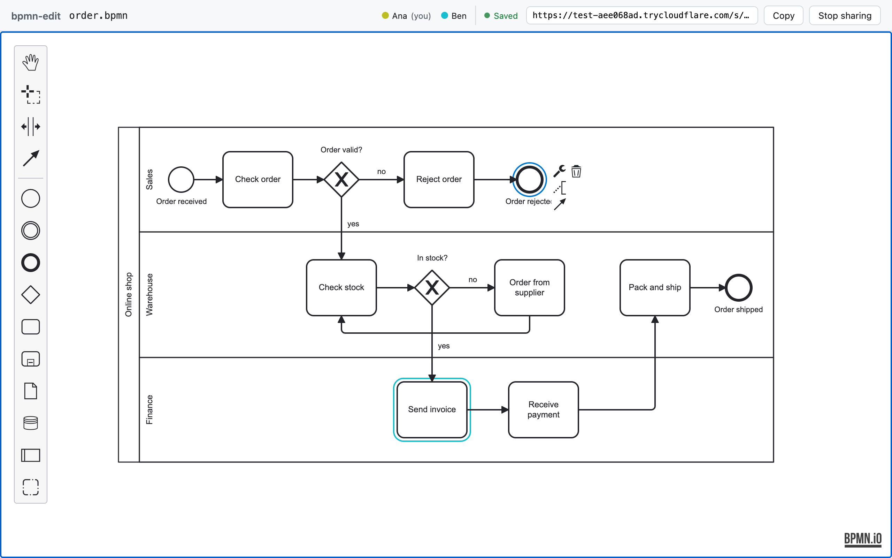
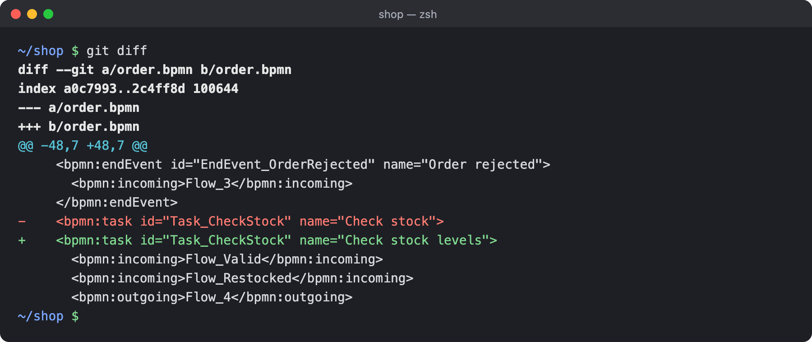

# bpmn-edit


Edit a `.bpmn` file from your repo together, live. One command opens it in a visual editor
([bpmn-js](https://bpmn.io)) in your browser. Click **Share**, send the link, and your colleagues edit with
you in real time. They need nothing but a browser: no install, no account. Every change is saved straight
back to the file on your disk, with clean git diffs.

Project page: **https://dreadboy.github.io/bpmn-edit/**

## Quick start

In your project folder, run:

```sh
npx bpmn-edit path/to/file.bpmn
```

There is nothing to install; you need [Node.js](https://nodejs.org) 20.19 or later. The editor opens in your
browser, and the terminal shows a line like this:

```
bpmn-edit: editing path/to/file.bpmn at http://localhost:3000/?host=<secret>
```

Keep the terminal open while you work. When you are done, press **Ctrl-C** in the terminal. Your last edits
are saved first, then bpmn-edit stops.



## Sharing

1. Click **Share** in the editor's toolbar.
2. After a few seconds you get a link. Click **Copy** and send it to anyone.
3. They open the link and edit with you, live. They don't need to install anything or sign up.
4. Everyone appears in the toolbar with their own colour, and you can see what each person has selected.
5. Click **Stop sharing** when you are done. The link stops working right away.

Every time you click Share (or restart bpmn-edit) you get a new link, so send the new one.

The first time you share, bpmn-edit downloads a small helper from Cloudflare (`cloudflared`), unless you
already have it installed. That takes a few extra seconds, once.



Anyone with the link can view and edit until you stop sharing; see [Safety](#safety).

## Requirements

- [Node.js](https://nodejs.org) 20.19 or later.
- Supported for now: **macOS** with **Google Chrome**. Other systems and browsers may work, but they are not
  officially supported yet (the automated tests also run in Firefox and Safari's engine, WebKit).
- Your collaborators only need a browser.

## Options

| Option | What it does |
|---|---|
| `-p, --port <n>` | Use this port instead of `3000`. If it is taken, the next free one is used. |
| `--create` | Create the file if it does not exist yet, without asking. |
| `--no-open` | Don't open the browser. Open the printed link yourself. |
| `-V, --version` | Show the version. |
| `-h, --help` | Show help. |

## Creating a new file

Point bpmn-edit at a file that does not exist yet, and it asks first:

```
new.bpmn does not exist. Create it? [y/N]
```

Answer `y` and you get a blank diagram with one start event, ready to edit. Anything else (or just Enter), and
nothing is created. This catches typos like `oder.bpmn`.

In scripts or CI (where nobody can answer), bpmn-edit doesn't ask. It stops with
`File not found: new.bpmn (pass --create to create it)`. With `--create`, the file is created without a
question; if it already exists, it is simply opened as it is.

A few rules: the folder must already exist, and the name must end in `.bpmn`. bpmn-edit never creates folders
and never overwrites a file.

## Colours

Select one or more elements (tasks, events, gateways, pools and lanes, data objects, sub-processes,
connections), click **Set color** (the paint bucket in the menu next to the selection) and pick a colour.
**Default** takes the colour off again. Colours are saved in the standard attributes that Camunda Modeler and
bpmn.io use, so those tools show them too, and colours already in a file show up in bpmn-edit. `git diff`
usually shows only the coloured elements' lines, plus the root element's line when a file gets its first
colour or loses its last one; an element's label may also be re-measured (its size line changes).

## What happens to your file

- **It saves itself.** There is no save button. Each change lands in the file a moment after you make it.
- **Clean git diffs.** A save changes only what you edited. Rename a task and `git diff` shows that one line;
  the rest of the file keeps its exact formatting, comments and all.

  

- **Your other tools keep working.** If your IDE, a `git checkout` or anything else changes the file, the editor
  shows the new version right away. If that happens while you are editing, your edits are put on top of it
  instead of being lost.
- **Side files, just in case.** In rare cases bpmn-edit can't safely write your edits into the file, for
  example when another program saved an older copy over them. Then it keeps your version next to the file,
  as `<name>.bpmn-edit-unsaved-<date-time>.bpmn` (or `…bpmn-edit-replaced-….bpmn`), and tells you in the
  terminal. You'll see these files in `git status`; they are never deleted automatically, so delete them
  yourself once you've checked them.

## Safety

- **Anyone with the share link can view and edit the diagram** until you click Stop sharing or stop
  bpmn-edit. There are no accounts or passwords, so send the link only to people you trust.
- Shared traffic goes through Cloudflare's network. Don't share diagrams you wouldn't send through a third
  party.
- The link printed in the terminal is your private one: whoever opens it can start and stop sharing. Don't
  share it.
- Without sharing, nothing leaves your machine: bpmn-edit only listens on `localhost`.

## Known limitations

- One file at a time.
- Two people changing the same thing at the same moment: the first change wins, and the other person sees a
  short notice.
- Undo history resets when someone else's change (or a change on disk) comes in.
- A share link stops working when you restart bpmn-edit; there are no permanent links.
- In rare cases a save rewrites more of the file than you edited; the terminal tells you when that happens.

## How it works

Curious about the details: exact timings, edge cases, how sharing is secured? See
[How bpmn-edit works](docs/how-it-works.md).

## License

bpmn-edit is MIT licensed, see [LICENSE](LICENSE).

It ships a prebuilt [bpmn-js](https://github.com/bpmn-io/bpmn-js) (in `web/vendor/bpmn-js/`, with its
[license](web/vendor/bpmn-js/LICENSE)), whose license requires that the bpmn.io watermark in the diagram (the
logo linking to https://bpmn.io) stays fully visible and unchanged; keep it that way in any fork or
modification. It also ships [bpmn-js-color-picker](https://github.com/bpmn-io/bpmn-js-color-picker) (MIT),
bundled in `web/vendor/bpmn-js-color-picker/` with its [license](web/vendor/bpmn-js-color-picker/LICENSE).
